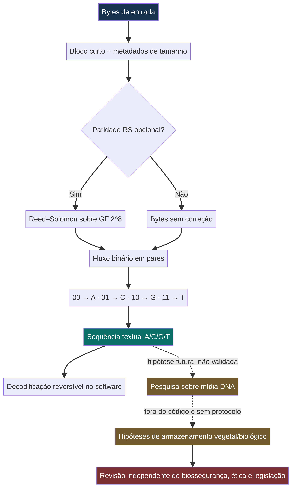
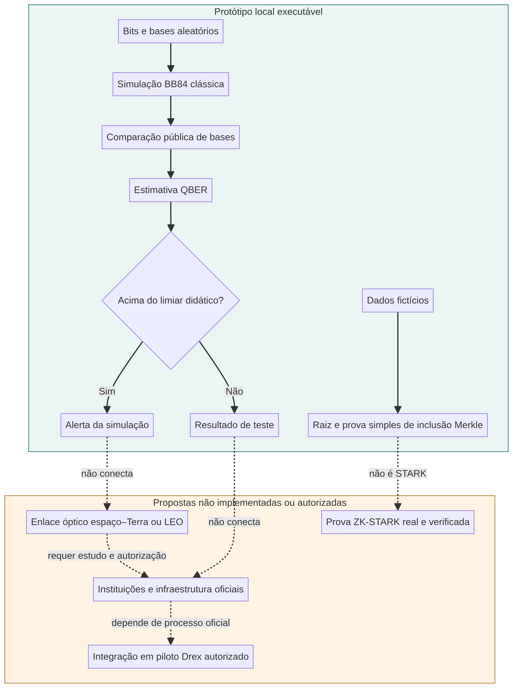

<p align="center">
  
</p>

# Projeto Ybyrá — Árvore-Mãe

<p align="center">
  <a href="https://www.python.org/"></a>
  
  
  
  <a href="LICENSE"></a>
  
  
</p>

> **Status:** protótipo de software em estágio inicial. Não há hardware biológico, enlace QKD orbital, prova STARK, integração com DREX, parceria institucional ou validação de segurança neste repositório. Os diagramas representam conceitos e componentes simulados, não sistemas implantados. O workflow de GitHub Actions ainda não está ativo; há um modelo revisável em `docs/CI-CD-Deploy.template.yml`.

O Ybyrá reúne demonstrações educacionais de codificação digital inspirada em DNA storage, análise explicável simples, detecção de eventos em traços MEA sintéticos, simulação BB84 e provas de inclusão Merkle. O objetivo de pesquisa informado é investigar tecnologias de computação e segurança com autonomia técnica e responsabilidade ambiental. O nome, o banner e a arquitetura são conceituais.

A relação com o **Plano Brasileiro de Inteligência Artificial (PBIA) 2024–2028** é contextual: o plano do MCTI promove infraestrutura, capacidades nacionais, formação, aplicações públicas, inovação e governança em IA. Este repositório não é iniciativa oficial do PBIA nem possui financiamento ou endosso governamental conhecido. O plano prevê R$ 23 bilhões em quatro anos, conforme a página oficial do MCTI [1].

## Responsabilidade e autoria informadas

Empresa responsável informada na especificação: **Impulso Digital Soluções em I.A. Ltda.** Autor/arquiteto principal informado: **Felipe Aquino (Fundador e CEO / Chief AI Architect)**. Essas atribuições foram fornecidas junto à solicitação e não foram verificadas independentemente. A publicação do código não constitui chancela da AEB, do Ministério da Defesa, do Banco Central, do Drex, nem de qualquer órgão público.

## 1. Visão executiva e soberania tecnológica

“Soberania” é aqui uma meta de projeto a validar, não uma propriedade automaticamente produzida por código aberto ou infraestrutura experimental. Ela dependeria, entre outros fatores, de controle efetivo da cadeia de software e hardware, governança de dados, competências, segurança, disponibilidade de fornecedores e auditoria jurídica. O Ybyrá é uma proposta exploratória compatível em tema com debates sobre capacidades tecnológicas nacionais; não é uma implementação do PBIA.

## 2. Computação inspirada em DNA storage

`src/dna_storage/b2n_encoder.py` mapeia cada par de bits para A/C/G/T e oferece paridade Reed–Solomon opcional por bloco curto. O programa trabalha apenas com bytes e strings em memória. Não sintetiza DNA, não lê material biológico e não transfere dados para plantas.

A hipótese de armazenamento em DNA e a hipótese de direcionamento a um genoma vegetal são áreas de pesquisa distintas com grandes desafios de densidade efetiva, custo, taxa de erro, latência, estabilidade, leitura, integridade e biossegurança. `crispr_targeting.py` apenas ordena registros de metadados fornecidos pelo usuário. Não projeta guias, sequências, vetores nem condições experimentais.



## 3. IA híbrida, Aurora XAI e sinais MEA

`aurora_xai_engine.py` fornece uma regressão logística mínima com contribuições ponderadas visíveis; não é um motor neuro-simbólico completo, modelo treinado ou sistema validado. `spike_sorting.py` detecta mínimos locais em séries numéricas, útil para demonstrações com dados sintéticos. Não faz inferência clínica, classificação de neurônios ou controle de organoides. Qualquer trabalho com células/organoides exigiria revisão ética, de biossegurança e de governança específica.

## 4. Malha Quântica Pindorama, Drex e criptografia

`qkd_pindorama.py` simula classicamente algumas etapas de BB84 e calcula a QBER nas posições com bases coincidentes. Não implementa estados quânticos, fótons, enlace espaço–Terra, autenticação, correção de erros, análise de chave finita ou certificação. QBER acima do limiar escolhido é apenas um alerta didático, não uma prova universal de ataque.

`zk_drex_integration.py` implementa um compromisso Merkle e uma prova simples de inclusão para dados fictícios. Merkle não é uma prova zero-knowledge nem um STARK. Não há integração com sistemas do Banco Central. O próprio BCB caracteriza o Drex como plataforma/piloto de testes, e a fase 2 aparece como encerrada na página pública consultada [2]. Qualquer participação ou integração real dependeria de elegibilidade, autorização, requisitos técnicos e processo formal do BCB.



A QKD também não substitui autenticação de origem nem resolve sozinha segurança de ponta a ponta. A NSA documenta limites de engenharia, implantação e disponibilidade e prefere, em seu contexto, criptografia resistente a computadores quânticos quando adequada [3]. O projeto não recomenda QKD para produção.

## 5. Matriz comparativa de impacto geopolítico

| Dimensão | Nuvens gerenciadas, como AWS/Azure | Ybyrá neste repositório |
|---|---|---|
| Maturidade | Serviços comerciais amplos, com garantias e limites descritos pelo fornecedor e contrato | Protótipo inicial, sem SLA, usuário ou validação externa |
| Capacidade operacional | Infraestrutura gerenciada e escalável, sujeita à região e ao modelo de serviço | Não oferece infraestrutura; são módulos locais em Python |
| Governança | Controles, regiões e certificações variam por serviço/contrato; devem ser avaliados caso a caso | Licença MIT e código visível; não assegura soberania de dados, cadeia de suprimentos ou jurisdição |
| Diferencial alegado | Eficiência e escala de serviços de nuvem | Agenda de pesquisa potencial em biocomputação e integração de tecnologias |
| Evidência disponível aqui | Não avaliada em benchmark | Testes unitários e simulações didáticas, sem benchmark comparativo |

Esta matriz compara categorias em nível qualitativo. Não afirma superioridade técnica, segurança, custo, desempenho nem autonomia do Ybyrá frente a fornecedores.

## 6. Instalação e execução rápida

Requer Python 3.10 ou superior.

```bash
git clone https://github.com/felipetjmg1-bit/projeto-ybyra.git
cd projeto-ybyra
python -m venv .venv
source .venv/bin/activate  # Windows: .venv\\Scripts\\activate
pip install -r requirements.txt
PYTHONPATH=. python - <<'PY'
from src.dna_storage.b2n_encoder import encode_bytes, decode_sequence
from src.quantum_mesh.qkd_pindorama import simulate_bb84

encoded = encode_bytes(b"Ybyra demo", parity_symbols=8)
print(encoded.sequence)
print(decode_sequence(encoded))
print(simulate_bb84(rounds=1000, eve_intercepts=True, seed=7).qber)
PY
python -m unittest discover -s tests -v
```

A demonstração de Reed–Solomon tem limite de bloco documentado no código. Os demais módulos usam a biblioteca padrão. Nenhum exemplo transmite dados a serviço externo.

## 7. Estrutura

```text
docs/CI-CD-Deploy.template.yml
README.md
LICENSE
requirements.txt
docs/ARCHITECTURE.md
docs/MATHEMATICAL_MODELS.md
docs/ASSETS/
src/dna_storage/
src/hybrid_ai/
src/quantum_mesh/
tests/
```

Os fontes editáveis Mermaid para os diagramas ficam em `docs/ASSETS/*.mmd`. A imagem do banner é uma ilustração conceitual. As referências visuais não usam marcas oficiais do governo. O CI template não é executado pelo GitHub Actions enquanto não for instalado em `.github/workflows/` com a permissão apropriada.

## 8. Contribuição

Abra uma issue para discutir escopo e limites antes de propor alegações de integração, desempenho ou segurança. Contribuições devem acrescentar testes reproduzíveis, explicitar hipóteses e evitar dados sensíveis. Não envie sequências biológicas, dados pessoais ou segredos. Mudanças em componentes com aplicação biológica, financeira ou de segurança precisam de avaliação especializada antes de qualquer uso fora de simulação.

## Licença

O código está sob a licença MIT. “Soberania” é objetivo de pesquisa e não uma licença alternativa nem uma garantia jurídica. Consulte [LICENSE](LICENSE).

## Referências

[1] [Plano Brasileiro de Inteligência Artificial, MCTI](https://www.gov.br/mcti/pt-br/acompanhe-o-mcti/transformacaodigital/plano-brasileiro-de-inteligencia-artificial).

[2] [Piloto Drex, Banco Central do Brasil](https://www.bcb.gov.br/estabilidadefinanceira/piloto-drex).

[3] [Quantum Key Distribution and Quantum Cryptography, NSA](https://www.nsa.gov/Cybersecurity/Quantum-Key-Distribution-QKD-and-Quantum-Cryptography-QC/).
